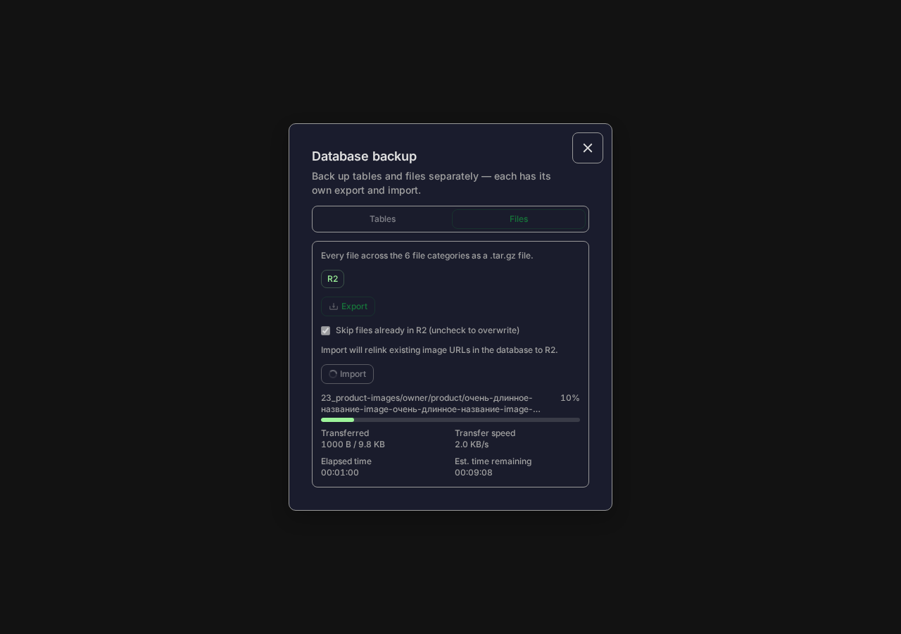
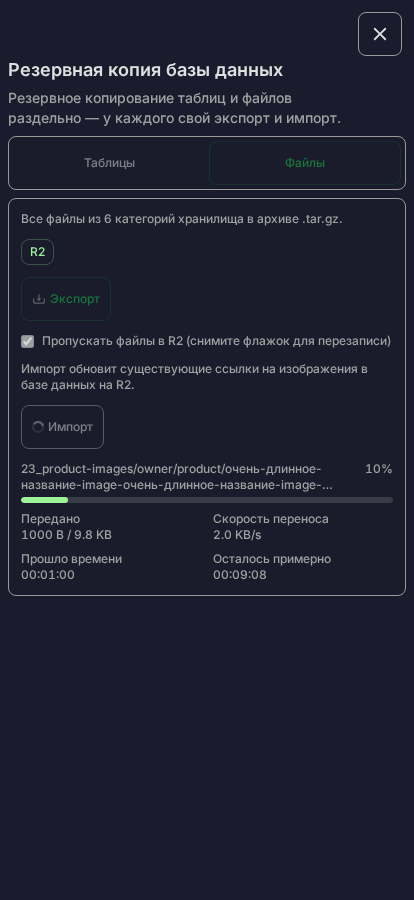
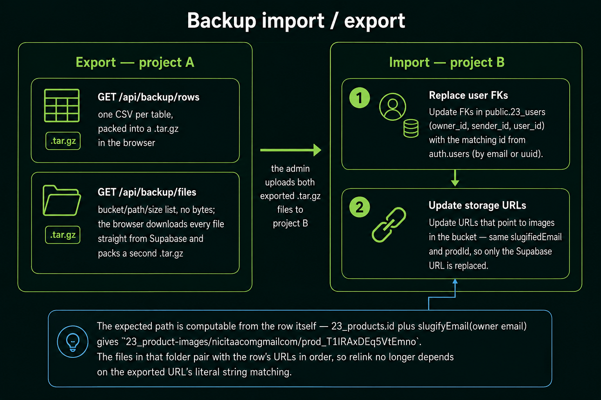

# 🗄️ DB Backup & Restore (ADMIN only)

ADMIN-only feature to export the project's tables and Storage files and import them back. Tables
and files are two **independent** flows — each has its own export and its own import — and file
bytes **never pass through a Vercel function**: the browser downloads/uploads Storage objects
straight to/from R2 in the Files tab. The provider SDK and local commands retain Supabase support.
Browser file imports/exports have a 512 MiB
working-data limit; larger exports and migrations use the local streaming command. This
replaces an earlier design that streamed a single combined archive through a Vercel function with
speed-aware chunking to fit the 60s cap — see "Why this design" below.

- Trigger: avatar dropdown → **DB Backup** item, visible only when `roles` includes `"ADMIN"`.
- Modal: `DbBackupModal` opened via `?modal=DbBackup`, with a Tables / Files tab switch.
- **Files: R2. Tables: Supabase.** Each tab shows its provider without a selector. Both Files
  buttons explicitly use R2. Files import automatically relinks the existing database and Auth
  image URLs to R2 after checking the destination files.
- **Skip files already in R2** is checked by default. Existing paths are reported as skipped;
  they use no upload signatures, capacity reservations or transfer bytes. Uncheck it to overwrite.
  Import still relinks image URLs when every file is skipped, so repeat the Files import after
  an earlier copy that left Supabase URLs unchanged. The Tables backup does not need importing.
- File progress shows transferred bytes, measured transfer speed, elapsed time and estimated time
  remaining. Long filenames occupy a fixed two-line area; the full name is available on hover.
- Active work belongs to the global Zustand `useDbBackupState`, so closing the modal keeps the
  export/import running and shows the same progress in a fixed card.



<br/>

## Why this design (not server-side streaming)

The previous version downloaded every Storage file server-side, gzipped the whole archive in a
Vercel function, and split the result into speed-sized chunks to stay under the 60s function limit
— the `CHUNK_BUDGET_MS`/`SERVER_THROUGHPUT_BYTES_PER_MS` math approximated how much a function
could pull from Storage in the time it had. That approximation is fragile: it does not actually
guarantee the limit is respected, it only estimates it.

The full transfer runs outside the function deadline: **no application request contains file bytes.**
Metadata operations still run on Vercel with `maxDuration = 60`: preparation covers at most 16 files,
completion at most four. Relinking handles one inventory page, 200 profile emails, or at most 20
database/Auth rows per request, with at most four concurrent reference updates.
Slow provider/Redis responses may still time out; bounded batches reduce
per-request work. A lost completion response is retried once using the same session IDs, without
another file transfer. Completed sessions return their existing result without another copy.
- Export: the server returns a file **list** (bucket/path/size/contentType, no bytes). The browser
  downloads each file directly from R2 and builds the `.tar.gz` locally.
- Import: the browser decompresses the archive locally, asks the server for a signed upload URL
  per file, then uploads straight to temporary keys in R2's single public bucket or Supabase's
  private staging. Completion verifies metadata and publishes the object through a provider-side copy.

Two things from the old design are kept anyway, because they're independently useful, not because
they were needed for the timeout problem:
- **Transfer speed display** — shown during the files tab's export/import ("~2.4 MB/s"). Not a
  separate probe against a fixed asset (an earlier version fetched `/favicon.ico` to measure
  throughput — that file does not exist in this project, so the probe 404'd every time and silently
  fell back to a hardcoded constant, which is why the number never varied). `createSpeedTracker()`
  in `BackupSDK.ts` instead computes a smoothed bytes/ms figure straight from the real transfer's
  own progress deltas (an exponential moving average, resampled at most every 200ms) — it reflects
  whatever is actually happening on the wire, no separate request involved.
- **Byte-accurate progress** — the files tab shows "23 MB / 230 MB", not a file count. Every file's
  size is known ahead of time (from the bucket listing on export, from the parsed archive on
  import), and `xhr.upload.onprogress` gives real in-flight bytes during upload.

<br/>

## What's in each archive

**Tables archive** (`23_backup-tables-<date>.tar.gz`) — one `.csv` per table:

```
23_users.csv
23_users_cart.csv
23_categories.csv
23_category_views.csv
23_products.csv
23_ai_price_runs.csv
23_ai_price_proposals.csv
23_personalized_designs.csv
23_tickets.csv
23_messages.csv
```

**Files archive** (`23_backup-files-<date>.tar.gz`) — every object in all 6 buckets, plus a mime-type
map so import restores the right `contentType`. Paths that exceed local filename/path limits or
contain characters reserved by Windows use short exported names with an original-path map:

```
storage-content-types.json
storage-paths.json                                 # present when paths were shortened
storage/23_product-images/<emailSlug>/<productId>/<titleSlug>-1.jpg
storage/23_ai-product-images/<emailSlug>/generated-image.png
storage/23_avatar-images/<emailSlug>/avatar.png
storage/23_support-images/<emailSlug>/2026-07-29_at_22-19-54.png
storage/23_support-guest-images/<deviceId>/2026-07-29_at_22-20-11.png
storage/23_product-personalization-images/<emailSlug>/<productId>/my-kovrik.jpg
storage-files/file-000001.avif                      # shortened entry, original key in storage-paths.json
```

`storageFilesTar.ts` keeps exported path components within 200 UTF-8 bytes and paths relative to the
extraction folder within 240 bytes. A longer or incompatible path becomes
`storage-files/file-<number>.<extension>`.
The separate prefix and unique numbers keep files with similar titles distinct. `storage-paths.json`
maps that exported entry to its original `bucket/path`; content types remain keyed by the original
`bucket/path`. Import restores the exact original Storage key, so table URLs still match. Older
backups with original `storage/<bucket>/<path>` entries remain supported.

- **Tables** (`BACKUP_TABLES`, FK-safe order, in `app/api/backup/backupConfig.ts`):
  `23_users → 23_users_cart → 23_categories → 23_category_views → 23_products → 23_ai_price_runs → 23_ai_price_proposals → 23_personalized_designs → 23_tickets → 23_messages`.
  The two AI-pricing tables export as empty CSVs until their manual SQL block has been run.
  `utm_stats` is **excluded** — it is shared across projects 14/23/28/29.
- **Buckets** (`BACKUP_BUCKETS`, mirrors `app/ts/types/TBuckets.ts`), one per purpose since plan-23:
  `23_product-images`, `23_ai-product-images`, `23_avatar-images`, `23_support-images`,
  `23_support-guest-images`, `23_product-personalization-images`. The retired `23_public-images` held
  all of them at once and is not exported — relink still reads a path out of an old URL naming it,
  see **Storage URL relinking** below.
- **Folder names are keyed on the slugified email**, never on `auth.users.id`: `nicitaacom@gmail.com`
  becomes `nicitaacomgmailcom`. A restore gives the same person a new `auth.users.id` in project B
  (see **Cross-DB restore** below), so a folder named after that id would be left behind after every
  restore, while the account's email never changes.

<br/>

## Files

| Area | File |
| --- | --- |
| Project-specific config: tables, column classification, buckets, public URL, file listing | `app/api/backup/backupConfig.ts` |
| Pure tar (.tar) build/parse + browser gzip (no Node deps) | `app/api/backup/tarClient.ts` |
| Extractable Storage backup paths + original-path map | `app/api/backup/storageFilesTar.ts` |
| Local repair of existing Files backups | `scripts/repair-backup-files.mjs` |
| Pure CSV read/write (RFC 4180) | `app/api/backup/csvClient.ts` |
| Stable re-export shim (routes + SDK import from here) | `app/api/backup/backupTables.ts` |
| ADMIN gate (string error or null) | `app/api/backup/requireAdmin.ts` |
| Auth-account preparation + source/target UUID map | `app/api/backup/auth-users/route.ts` |
| Pure source-user validation and row remapping | `app/api/backup/backupAuthRestore.ts` |
| Rows GET (export) / POST (import, ≤500/batch) | `app/api/backup/rows/route.ts` |
| Files GET (list, paths only) / POST (signed upload URLs, ≤16/batch) | `app/api/backup/files/route.ts` |
| Files completion POST (≤4/batch, verified provider-side copies) | `app/api/backup/files/complete/route.ts` |
| Storage URL relink POST (scan target paths, update rows/Auth metadata) | `app/api/backup/relink-storage-urls/route.ts` |
| Pure recursive Storage URL parser/relinker | `app/api/backup/backupStorageRelink.ts` |
| Client SDK — export/import × tables/files, relink finalizer + live speed tracker | `app/sdk/BackupSDK/BackupSDK.ts` |
| Global state for all 4 flows and modal visibility | `app/store/ui/useDbBackupState.ts` |
| Hook (starts the SDK work and supplies toast + i18n) | `app/components/ui/Modals/DbBackup/hooks/useDbBackup.ts` |
| Always-mounted progress card + page-leave warning | `app/components/ui/Modals/DbBackup/DbBackupProgressCard.tsx` |
| Modal UI (Tables/Files tabs, progress, results) | `app/components/ui/Modals/DbBackup/DbBackupModal.tsx` |
| Response types | `app/ts/namespaces/api/backup/api.d.ts` |

<br/>

## Progress after closing the modal

`useDbBackupState` owns the export/import state independently of the modal lifecycle.
`ModalsQueryProvider` keeps `DbBackupProgressCard` mounted even when `?modal=DbBackup` is absent.
Closing and reopening the modal therefore reconnects to the same export/import and current
progress without a React context provider.

During active work, closing the modal shows a non-dismissible bottom-right card with the operation,
progress, current table/file label, transferred bytes, transfer speed, elapsed time and estimated
remaining time. A
`beforeunload` listener also requests the browser's standard confirmation before closing or
reloading the page. The listener and progress card are removed as soon as the work succeeds or
fails.

Elapsed time includes preparation and verification, updates once a second and freezes on completion
or error. Remaining time uses `elapsed × (1 − progress) / progress` and the current transfer-speed
estimate, choosing the longer duration so a short upload-speed spike does not hide verification
time. A slowing connection extends the estimate. Unknown speed still allows a progress estimate;
zero speed displays `00:00:00` by the user's choice. Before either estimate is available it shows
`—`. After all files have transferred or been skipped, verification and relinking show Finalizing.
Skipped files advance the percentage but do not inflate transferred bytes or measured speed.

`BackupFilesProgress` shares the modal/card presentation. The filename uses two reserved lines
(`line-clamp-2 min-h-[2rem]`) and wraps within `min-w-0 flex-1`; the percentage uses `shrink-0`.
A two-column `dl` separates labels from values, keeping English/Russian text within mobile widths.
The Storybook `Admin/AdminTools → BackupCopyToR2` fixture covers provider labels, long-path height,
overflow and timing. Browser verification covers import/export and the floating card at 320, 414
and 1280 px; screenshots use fixture data rather than live transfer measurements.



<br/>

## The `backup_23_tables()` SQL function is no longer called

The old export route read every table in one round trip via `supabaseAdmin.rpc("backup_23_tables")`.
The new `rows/route.ts` does a simple `select("*")` per table instead (admin-gated, no per-row
scoping — this schema has no per-user ownership model). The SQL function itself is left in the
database, unused — dropping it is a separate decision on shared infrastructure, not made by this
change. See the **DB BACKUP FUNCTION** section in `dev_readme-supbase-sql.md` if it's ever revisited.

<br/>


`public/docs/backup/backup-import-export-workflow.png` — export/import + storage URL relink
(prompt 4 of 4, [plan-23 §5](plans/plan-23-storage-buckets-email-slug.md#5-image-prompts))

## Export flow

**Tables:** `GET /api/backup/rows` returns every table's rows as JSON (small, no Storage bytes). If
an exported cart/product/design references an Auth user through a real FK whose public `23_users`
profile is missing, export reads that specific account from Supabase Auth and adds a safe `USER` profile to
`23_users` in the archive. The browser then converts each table to CSV (`toCsv`), packs a
`.tar.gz` locally, and downloads it. This makes one-click Export self-contained for one-click
Import without permanently inserting the synthesized profile into the source database.
UUID-looking ids in historical TEXT columns (tickets, messages, category views) are preserved as
history and do not require a still-existing Auth account.

**Files:** `GET /api/backup/files` returns every stored file's bucket/path/size/contentType (no
bytes and paginated provider download URLs) → the browser downloads each file directly from R2 (5 concurrent
downloads) → packs a `.tar.gz` locally → downloads it. Progress is byte-accurate: `bytesDone` sums
the `size` of each file as its download completes, against `bytesTotal` from the file list.

To export R2 through the UI, sign in as **ADMIN → DB Backup → Files → R2 → Export**. This works
while the active provider remains Supabase. Export checks all six category prefixes, skips empty
prefixes and folder markers, and follows every inventory page. Downloads use the configured
R2 custom domain and its GET CORS policy. The archive preserves original category/path keys,
file bytes and MIME types, including mapped names for long or Unicode filenames. Temporary
`temp-uploads/` and retained legacy `uploads/` objects are excluded. Export lists, inspects and downloads files; it creates no R2 objects.
The downloaded file is `23_backup-files-YYYY-MM-DD.tar.gz`, compatible with either provider's
Files import. Browser backups are limited to 512 MiB; use the streaming command below for larger backups.

### Repair an existing backup that fails extraction

The reported aloe-vera filename is **294 bytes**, above the usual 255-byte filename-component limit.
GNU tar's long-name headers preserve that name inside the backup file, but extraction still needs a name
the destination filesystem accepts. Clicking **Yes** skips an error; it does not shorten the name.

From the repository root, using the same Node version as `pnpm test:keys`, run:

```bash
pnpm backup:repair-files ~/Downloads/23_backup-files-2026-10-09.tar.gz
```

This writes `23_backup-files-2026-10-09-extractable.tar.gz` beside the source, leaving the source
intact. An optional second argument selects another output path; an existing output file is refused.
Extract the new `.tar.gz` with the archive manager or `tar -xzf`. Files with short compatible paths
stay in `storage/`; shortened entries sit in `storage-files/`, with their original keys in
`storage-paths.json`. To restore into Supabase, select this repaired archive directly in **Files →
Import**. Both the repair command and the browser use the same path mapping; no Supabase rename,
table update, SQL, environment change, or network request is required to repair a local backup.

Code changes apply to new exports. Existing downloaded backups need this repair or a fresh export.

<br/>

## Import flow (upsert — NOT override)

**Tables:** upload a `.tar.gz` (from export) or loose `.csv` files. The browser parses and validates
all CSVs locally, coerces columns per `backupConfig.ts`, automatically prepares/reuses target Auth
users, remaps source user UUIDs, and only then POSTs `≤500` rows per table per batch to
`/api/backup/rows`. The server upserts on each table's primary key (`onConflict`). Rows with an
empty/invalid uuid column are dropped before the upsert (`filterRowsByUuidColumns`) and reported as
`skipped`, so one bad row cannot fail an entire batch with a `22P02` (text = uuid) error.
CSV keeps `null` as an unquoted empty field and `""` as a quoted empty field, so empty text survives
the round trip. For older archives where both forms were unquoted, import restores a null
`23_tickets.last_message_body` to its database default (`""`) before upsert.

**Files:** upload one `.tar.gz` (from export or local repair). The browser decompresses and parses it
locally, resolves short exported names through `storage-paths.json`, then asks `/api/backup/files`
for signed temporary upload destinations (up to 16 files per metadata request). The server measures
inventory once and atomically reserves the entire batch, including temporary/publication copies.
Verified ADMIN authorization and the shared 10 GB capacity limit apply. The browser runs up to eight
PUTs directly to R2's `temp-uploads/` prefix in the same public bucket, then calls
`/api/backup/files/complete` for at most four files per request. Verification and publication run
with up to four files in parallel under one capacity lease. Only verified size and MIME are published
with overwrite behavior. Failed files are counted separately; progress includes actual transferred
bytes and excludes form overhead. Legacy pending `uploads/` sessions still complete safely.

The SDK and local commands retain the Supabase provider for rollback; its staging bucket permits
50 MiB per browser-uploaded file. Browser archives have a 512 MiB limit; larger backups use the
local streaming commands. Cleanup remains controlled separately, with a 24-hour temporary-file
grace period; it is disabled by default during the first migration copy.

**Storage URL relinking:** Tables import and Files import into the active provider finish by calling the ADMIN-only
`POST /api/backup/relink-storage-urls`. Calling it from both flows makes the restore order
independent: a Tables-first restore reports paths that are not uploaded yet, and the later Files
import resolves them; a Files-first restore resolves them when Tables are imported.
Files import explicitly chooses R2 for relinking, including when every file is skipped or an older
deployment still has a Supabase provider override. Table restore targets the active provider, which
now defaults to R2. Each request advances one page in an ADMIN-owned Redis session; retrying an
already completed step returns its stored result. The operation and its continuations retain the
ADMIN and same-origin checks. Rows update through the existing comparison RPC and reference
journal, preserving concurrent edits and unrelated fields.
The route lists the objects currently present in all six logical categories, then recursively
checks only the configured URL-bearing columns:

- `23_users.avatar_url`
- `23_products.img_url`, `variants`, and `personalization`
- `23_ai_price_proposals.proposed_variants`
- `23_personalized_designs.source_url`
- `23_tickets.owner_avatar_url`
- `23_messages.images` and `sender_avatar_url`
- Supabase Auth `user_metadata.avatar_url`

An old public URL is rewritten to `NEXT_PUBLIC_R2_PUBLIC_URL` for Files imports, or the selected
provider's public domain, when its exact `bucket/path` exists at the destination — and, since
plan-23, also when the row's own folder holds the file under a different name.
Already matching URLs, external/invalid/data URLs, and URLs with neither an exact
match nor a folder match remain unchanged. Missing references and unique paths are returned as an
unresolved warning in the modal; they do not fail an otherwise successful import. Re-running the
finalizer is safe and idempotent. After it succeeds, the client refreshes the current route so
server-rendered image data is fetched again.

**Matching by the row's own folder** (`selectStorageFolder` in `backupConfig.ts`,
`selectRelinkedPathsByFolder` in `backupStorageRelink.ts`). An exact string match alone leaves every
pre-plan-23 row unresolved: those URLs name `23_public-images/<old auth id>/…`, a bucket and a
folder nothing answers to any more. The restored row itself still says where its images belong now:

| Table | Folder built from the row | Example |
| --- | --- | --- |
| `23_users.avatar_url` | `23_avatar-images/<slugifyEmail(email)>` | `23_avatar-images/nicitaacomgmailcom` |
| `23_products.img_url` (+ `variants`, `personalization`) | `23_product-images/<slugifyEmail(owner email)>/<id>` | `23_product-images/nicitaacomgmailcom/prod_T1IRAxDEq5VtEmno` |
| `23_personalized_designs.source_url` | `23_product-personalization-images/<slugifyEmail(buyer email)>/<product_id>` | `…/nicitaacomgmailcom/prod_T1IRAxDEq5VtEmno` |

The email is read from `23_users.email`, keyed by the row's `owner_id` — except for
`23_personalized_designs`, which is keyed on `user_id`: the design file was uploaded by the buyer,
while `owner_id` on that table is the shop owner of the product.

Every stored file is indexed once by `bucket/folder`. Relinking accepts a unique filename match
or a single unresolved image with a single candidate. Multiple ambiguous product images stay
unresolved and are reported; array position is not evidence of file identity. Exact comparison
updates preserve concurrent row edits, including reordered arrays and newly added variants.

**Matching by file name — how the files got into those folders in the first place.** The folder
match above finds a row's images only once the files already sit in the new folder, and the
2026-08-06 move is what put them there. That move could use neither matching mode: the export was
flattened by hand into a folder that matches neither the path the objects had nor the path they were
going to, so the stored path was useless on both sides.

The **file name** was the one surviving link. All 1092 exported objects have distinct names, so the
tail of the URL a row still held identified the file on disk exactly, and the position in `img_url`
gave the order the folder match needs. The new name was rebuilt from the row — `slug(fi title)-N` —
never copied from the old one, which is how `1pc-of-beard-bib-7_price_1TIRAxDEq5VtEmnoKqCekBvA.avif`
became `1pc-of-beard-bib-7.avif`. The `_price_<priceId>` tail was read only as a check: a file naming
a different price than the product row it landed on was reported, not uploaded.

That move ran from `backup.ts` at the repo root, written to be deleted once the shop showed its
images, so this paragraph is the record of it. A later restore needs none of it — every file written
since plan-23 already sits at the path its row names.

For the 2026-08-03 migration archive, 861 of 1,071 database Storage URL references match the
current files archive. The remaining 210 references (170 unique paths) point to files absent from
that export and intentionally stay unchanged. That run predates plan-23, so it was measured on
exact-string matching alone, against the 2 buckets of the time.

Since plan-23, a restore needs the 6 buckets to exist in project B first — the **SQL query for
buckets + policies** section of `dev_readme-supbase-sql.md`, run in the Supabase SQL Editor. No
environment change beyond `NEXT_PUBLIC_SUPABASE_URL`, which is already set.

Progress on both flows is byte-accurate on the files tab (`23 MB / 230 MB`) and count-based on the
tables tab (`3 / 10 tables`) — CSV rows are not large enough for byte progress to be meaningful.

<br/>

## Security

- All backup routes (`rows`, `files`, `auth-users`, `relink-storage-urls`) are gated by the existing `requireAdmin()` — returns 401
  (unauthenticated) or 403 (not ADMIN). Non-admins hitting the routes directly are rejected.
- All DB/Storage access uses `supabaseAdmin` (service role), which bypasses RLS — bucket policies
  do not affect export/import.
- There is no per-row or per-file ownership in this schema — `requireAdmin()` is the entire access
  boundary (unlike a per-user project, where each table/file would also need its own scoping — see
  `19_spotify-clone`'s `dev_readme-backup.md` for that shape).

<br/>

## Cross-DB restore — Auth users are prepared automatically during Tables import

### `auth.users` is never exported or imported — only `public.23_users.csv` is

`auth.users` is Supabase-managed and read-only from this app — it is never exported or imported
directly. What gets exported is `public.23_users.csv`, and each row's `id` there is the account's OLD
uuid from project A (Supabase A's own `auth.users`). Importing into a fresh project B, B's
`auth.users` has no row for any of these people yet, so `POST /api/backup/auth-users` creates a
brand-new B-side account with a brand-new uuid for each one. `23_users.id` is then rewritten from the
old project-A uuid to that new project-B uuid before the row is upserted — required by
`23_users.id REFERENCES auth.users(id)`: inserting the old project-A uuid into project B would fail
the foreign key, since no `auth.users` row with that uuid exists there.

Every FK column pointing at a person (`owner_id`, `sender_id`, `user_id`, …) is rewritten the same
way. This is exactly why a Storage folder is named after the email and not the id: the id the person
holds after a restore is a different one, the email is the same one.

```
Supabase A: user.id lives in auth.users, exported into 23_users.csv as row.id
        │
        ▼
23_users.csv imported into Supabase B — that row.id is still Supabase A's uuid
        │
        ▼
Supabase B's auth.users has no row under that uuid (this person never signed up here)
        │
        ▼
POST /api/backup/auth-users creates one — a brand-new Supabase B auth.users row, brand-new uuid
        │
        ▼
23_users.id (and every FK: owner_id, sender_id, ...) gets rewritten from the
Supabase A uuid to the new Supabase B uuid, so 23_users.id matches Supabase B's
own auth.users.id — required by 23_users.id REFERENCES auth.users(id)
        │
        ▼
the account's email never changed through any of this
        │
        ▼
slugifyEmail(email) → same Storage folder as before the restore
```

There is no separate Auth-import button or manual account step. After the admin selects the Tables
archive, `BackupSDK.importTables()` parses and validates every CSV first, then calls the ADMIN-only
`POST /api/backup/auth-users` before the first public-table upsert. That route reuses a target Auth
user by UUID/email or creates a passwordless Auth user, and returns a source UUID → target UUID
map. The SDK applies that map to users, carts, products, AI proposals, personalized designs,
category views, tickets, and messages before restoring them in FK-safe order.

The archive never contains passwords or password hashes. A newly created user whose archived
`providers` includes `credentials` gets `23_users.password_reset_required = true`; password login
is blocked with a recovery action until `/api/auth/reset` changes the password and clears the
marker. Google-only accounts are created with their archived confirmation state, and Supabase
links the Google identity when the user next signs in with the same verified email. Existing target
accounts (including the bootstrap admin) are reused and keep the union of their roles/providers.

Preparation is retry-safe: Auth users created before a later failure hold the source id in Auth
app metadata, so another import reuses them and retains the recovery requirement. A partial table
import without `23_users.csv` still works when every referenced UUID already exists in target Auth;
otherwise it stops before table writes and requests the missing profile CSV.

An archive exported before missing-profile completion was added must be exported again; changing
the importer cannot recover an email that is absent from the old archive.

`23_tickets.owner_id` is TEXT with no auth FK, confirmed live — those rows always restore.
`23_messages.sender_id` is **settled: TEXT, no FK**. Nikita read the live constraints (plan-03 task 1)
and the only ones on these two tables are `23_tickets_pkey`, `23_messages_pkey` and
`23_messages_ticket_id_fkey` (`ON DELETE CASCADE`) — the `23_messages_sender_id_fkey` from the old
import screenshot is gone, so anonymous rows (`sender_id = anonymousId_…`) import and restore like any
other row. A fresh project gets the same shape from `dev_readme-supbase-sql.md`; its **ANONYMOUS
TICKETS CLEANUP** section holds the pg_cron job that deletes anonymous tickets after a month of
silence from the anonymous owner.

<br/>

## Porting this feature into another project

See `19_spotify-clone`'s `app/features/backup/dev_readme-backup.md` — it documents this exact
architecture as a copy-paste SOP (which files to copy, the `backupConfig.ts` contract, the
questions to ask, files to request if missing) and already has two worked examples: a per-user
project (`19_spotify-clone` itself) and an admin-gated, no-scoping project (`26_hot-delivery`,
same shape as this one). 23_store additionally keeps the connection-speed display and
byte-accurate progress described above — neither exists in the spotify version, both are explicit
requirements here.

## Interchangeable storage and large portable backups

Provider setup, shared capacity, temporary upload keys and cleanup are documented in
[dev_readme-storage.md](dev_readme-storage.md). Follow the
[migration runbook](dev_readme-storage-migration.md) for the existing Files export, cutover and
rollback. The per-user 1 GB allowance and $0.30/GB/month upgrades remain plan TODOs; ADMIN is
exempt from those future limits/fees, while the shared 10 GB capacity applies to every role.

For a backup larger than the 512 MiB browser limit, export locally in a stream:

```bash
pnpm storage:migrate --operation export --source r2 --archive '/absolute/path/new-files.tar.gz' --manifest '/absolute/path/new-export.json'
pnpm storage:migrate --operation export --source r2 --archive '/absolute/path/new-files.tar.gz' --manifest '/absolute/path/new-export.json' --apply
```

Use `--source supabase` to export legacy files. Dry-run writes the inventory report only; `--apply`
writes a new portable gzip/tar, preserving MIME/path mappings and checking that source files do
not change during export. Existing filenames are never overwritten. Large import/copy uses the
runbook's streaming archive command and verifies SHA-256 by provider read-back.
