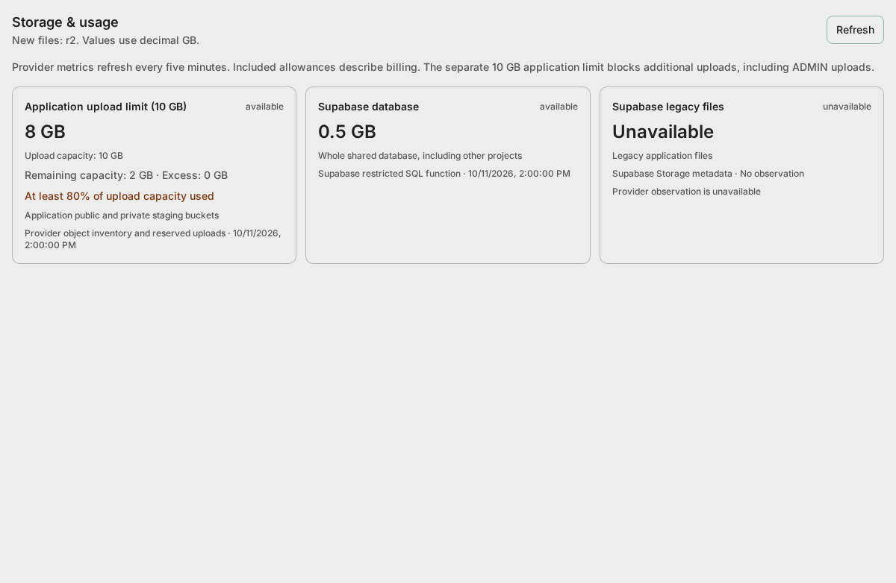
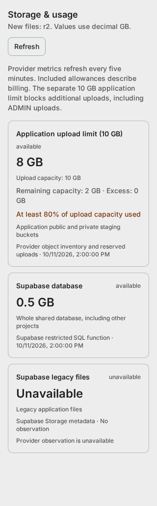

# Storage & usage UI

## 0. Why this exists

ADMIN needs visible application capacity and provider billing metrics before another quota
warning arrives. A missing provider observation must stay unavailable; it is never a zero.

## 1. What it looks like and where it lives

Open the existing ADMIN workspace and select **Storage & usage** in its header. Normal users
do not see this action. The component also checks the ADMIN role and the route repeats verified
auth/database-role checks before reading server-only provider credentials.

Component: `app/components/ui/Modals/AdminPanel/components/StorageUsage.tsx`.
Recipe: `storybook/admin/StorageUsage.stories.tsx` (Available, WarningAtEightGB, LimitReached,
Stale, NonAdmin and Mobile). Stories use labelled fixture measurements, not live account usage.





```text
GET /api/storage/usage → Cloudflare GraphQL + restricted Supabase SQL + provider inventory
    Redis storage:23:usage: last successful observations, refreshed every five minutes
    StorageSDK.usage() → useSetStorageUsage → Zustand useStorageUsage → StorageUsage cards
```

Types: `app/ts/storage.ts`; API contract: `app/ts/namespaces/api/storage/api.d.ts`.
Policy: `app/config/r2Config.ts`. State and error live in `app/store/admin/useStorageUsage.ts`;
the fetching hook holds the skeleton flag and refresh callback.

## 2. Labels and units

The **Application upload limit** is enforced capacity. With current policy it warns at
80% = **8 GB**, and at 10 GB says uploads are blocked, including ADMIN. Display decimal GB
(1 GB = 1,000,000,000 bytes). Capacity includes staging and pending reservations, so it can
exceed published image bytes. Verified ADMIN has no future per-user allowance or storage fee;
the shared limit remains. Per-user/paid-storage controls are still plan TODOs.

R2 **included allowance** is a billing comparison for the entire account. Its 10 GB-month value
is separate from the application's hard limit. Current bytes are a snapshot, not monthly billed
GB-month. Latest bucket observations are selected once; historical snapshots are never summed.
Class A/B requests and reported downloads cover the current month. Reported downloads omit
transfers below 100 KiB. Unknown storage classes leave Standard allowance comparisons unknown.

Supabase database size covers the shared database, including other projects. Legacy-file usage
counts this application's six buckets. Supabase egress is separate and has an explicit provider
dashboard link when reliable telemetry is absent. Unknown plan allowances stay unknown.

## 3. States and responsive behavior

Every card shows source, scope, observation time, value and available/stale/unavailable state.
Refresh preserves previous successful measurements when provider refresh fails. The initial
skeleton shows Checking storage usage; the empty state offers Refresh; request errors are alerts.
Warnings use the theme's accessible warning color. One column at 320 px expands to two on tablets
and three on larger screens. Cards wrap scope text and the header wraps its refresh control.

## 4. Verification and deployment

Browser/Storybook checks cover the 8 GB warning, 10 GB rejection wording, non-ADMIN visibility,
unavailable measurements, mobile overflow and accessibility. Live R2 measurements require the
analytics token and actual buckets described in [storage setup](dev_readme-storage.md).
Follow the [migration runbook](dev_readme-storage-migration.md) for live file/network checks.
