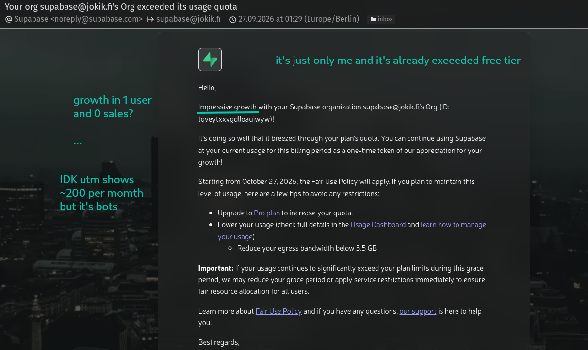

# plan-01 — supabase-and-cloudflare-r2-migration

> **THIS PLAN SHOULD NOT BE DELETED AFTER COMPLETION.** Preserve it as decision history,
> including the original requirements, alternatives, costs, and rollback reasoning, so future
> changes do not repeat the same mistakes.

**Priority:** P0 — highest-priority implementation plan  
**Recommended model:** GPT-6.1-sol · xhigh  
**Status:** see [plan-00-tracker.md](plan-00-tracker.md)  
**Decision date:** 2026-10-10  
**Depends on:** existing completed work committed on its current branch before starting the migration branch

## §1 — Decision and reason



Keep the **existing Supabase deployment for tables, authentication, queries, and existing realtime
behavior**. Move application files from Supabase Storage to **Cloudflare R2 Standard**.

The immediate triggers are an email about exceeding a 5 GB allowance and the absence of an ADMIN
view showing usage and remaining allowance.

This is a **file-storage migration**, with compatible URL updates in database records. R2 is object
storage; PostgreSQL remains in Supabase. Existing records and users stay in the current database.

The intended benefits are lower file-storage and delivery costs, fewer file bytes passing through
application servers, and less dependence on VPS-hosted storage. This plan keeps the current database
deployment and VPS services; claim infrastructure savings only after the corresponding services
are actually retired.

A 5 GB warning could refer to egress. Supabase documents separate cached and uncached egress
allowances; confirm the affected metric from the email or provider dashboard before attributing
the incident to stored file size. Moving files reduces file-related usage, while database traffic,
other quotas, and free-project availability remain separate concerns.
[Supabase egress documentation](https://supabase.com/docs/guides/platform/manage-your-usage/egress)

### Ctrl+F — original user verbatims

Keep these exact strings, including spelling, so the reasoning is searchable:

> "email that mentions that I exeeded some 5 GB limit also it's no way for ADMIN role to see how much space left"

> "can I show on UI in that next.js website total used / total free"

> "So arch would be supabase for tables AND Cloudflare R2 for files"

> "Assiming I already have .tag.gz backup files and I want it to work approxiamtely same as supabase so I may back to supabase one day if I need"

> "Assuming that it means that all supabase related data should stay e.g dev_readme-supbase-sql.md etc"

> "reduce VPS load and amount of projects hosted on single VPS to reduce load and cost"

> "Total for 20 GB\t$0.15/month on Cloudflare R2 means as 1.5$/year for 20GB and approx 5.5$/year for 40GB that's a good Google Drive alternative"

The cost wording above records the original estimate; the corrected arithmetic is in §2.

> "write DECIDED AGAISNT section that we DECIDED AGAINST S3 because of cost"

> "this SHOULD NOT be deleted after plan is done in order to don't repeat same mistakes over and over"

> "this will be stored as history so others know the reasoning of this decision"

> "what I mean is shift every other plan means that current plan-01 becomes plan-02 current plan-02 becomes plan-03 etc"

> "each user has 1GB of data to upload when limit exeeded it ask about 0.3$ per GB/month to upload more images to sell more"

> "in order to avoid scam I want to set limit of 10GB for now in total for all users so it not exeed anything"

> Actually "23_avatar-images" is PUBLIC because other users might see reviews and avatars of other users also it's usefull when buyers can see seller avatar

> that's why I think I need only
> 23-store-public

Interpret `.tag.gz` as the existing `.tar.gz` backup format; inspect archive contents rather than
assuming the extension proves compatibility.

## §2 — DECIDED AGAINST / DECIDED AGAISNT

**DECIDED AGAINST Amazon S3 for this migration because of cost**, particularly direct internet
delivery above included allowances. Using the AWS S3 SDK with R2 remains acceptable: S3 API
compatibility does not mean purchasing AWS storage.

Illustrative USD costs, checked on October 10, 2026:

| Item                              | Cloudflare R2 Standard | Amazon S3 Standard                                                |
| --------------------------------- | ---------------------- | ----------------------------------------------------------------- |
| Storage rate                      | $0.015/GB-month        | Representative $0.023/GB-month                                    |
| 20 GB stored continuously         | $0.15/month            | $0.46/month                                                       |
| 40 GB stored continuously         | $0.45/month            | $0.92/month                                                       |
| 100 GB internet delivery/month    | $0                     | $0 if the eligible 100 GB AWS allowance remains available         |
| 1,000 GB internet delivery/month  | $0                     | About $81 with 100 GB allowance available and $0.09/GB thereafter |
| 20 GB storage + 1,000 GB delivery | $0.15 + requests       | About $81.46 + requests                                           |
| Request charges                   | May apply              | May apply                                                         |

R2 includes 10 GB-month of Standard storage, 1 million Class A requests, and 10 million Class B
requests monthly. Above those allowances, requests cost $4.50/million Class A and $0.36/million
Class B, with billing-unit rounding. Allowances apply across the account, not separately to every
application. [R2 pricing](https://developers.cloudflare.com/r2/pricing/)

AWS estimates assume representative US East pricing, direct S3 delivery, and the shared AWS
internet-transfer allowance being otherwise unused. Region, credits, CloudFront arrangements, and
account usage can change the comparison. With that allowance already consumed, another 100 GB
would cost about $9 in transfer at the representative rate.
[Amazon S3 pricing](https://aws.amazon.com/s3/pricing/)

**Corrected annual storage estimates:** 20 GB is approximately **$1.80/year**; 40 GB is approximately
**$5.40/year**, assuming the R2 allowance remains available every month. These exclude requests,
taxes, domains, and other services. Storage is billed as GB-month, so duration and changing usage
matter. Recheck prices before implementation and preserve this dated comparison as history.

Also considered:

- **Convex:** defer; reactive application changes do not solve this file-storage issue alone.
- **Appwrite:** defer; replacing authentication and database behavior adds unnecessary migration scope.
- **Self-hosted PostgreSQL plus object storage:** defer; additional database operations conflict with
  the immediate aim of reducing infrastructure work.
- **Keeping all files in Supabase Storage:** retain as a supported rollback destination, but use R2
  for the chosen cost model.
- **Google Drive replacement:** inexpensive object storage is useful, but building Drive-style
  synchronization, sharing, and document editing is outside this plan.

## §3 — Architecture and compatibility

```text
Next.js application
  ├── Supabase: tables, users/authentication, queries, existing realtime behavior
  ├── Server: authorize file operations, issue signed URLs, query usage metrics
  └── Browser ↔ Cloudflare R2: direct uploads and file downloads
                   └── Supabase rows retain compatible file references
```

### Storage behavior

Introduce a server-side storage interface with **Supabase and R2 implementations** for listing,
inspecting, signing uploads/downloads, deleting, and resolving file references.

Use one application-specific **public** R2 bucket, `23-store-public`, with the existing six logical
bucket names as object-key prefixes. Avatars are public because reviews and seller profiles show
them to other users. Public reads and permission to upload/delete are separate: writes still
require server authorization.

- `23_product-images`
- `23_ai-product-images`
- `23_avatar-images`
- `23_support-images`
- `23_support-guest-images`
- `23_product-personalization-images`

The R2 key is `<logical-bucket>/<existing-path>`. Preserve existing email-slug folders, guest
folders, product IDs, filenames, MIME types, and overwrite behavior.

Keep current database URL fields compatible. Normalize recognized URLs internally into
`{ provider, bucket, path }`; avoid a wholesale replacement of existing columns. Support mixed
Supabase/R2 references during migration and rollback. External URLs remain untouched. Recognize
only configured storage origins and valid bucket/path forms; avoid guessing from URL suffixes.

Use a production custom domain for public files. All six application categories are intended to
be public. No private R2 bucket is required by this architecture. Source inspection still stops
on any private source category so an access mismatch is resolved explicitly before copying.
R2's development public endpoint is not the production delivery endpoint.
[R2 public buckets](https://developers.cloudflare.com/r2/buckets/public-buckets/)

### API and authorization

Add a Storage SDK and typed API contracts following the repository's SDK → route → helper
conventions:

- Upload preparation: validated purpose, filename, content type, size, and associated entity.
- Upload completion: verify the stored object before returning a persistable file reference.
- Authorized listing and deletion.
- ADMIN-only usage retrieval.

The server derives permitted folders from verified Supabase identity, ownership, and existing guest
identity verification. Authorization uses trusted identity, not a client-supplied email slug, user
ID, or arbitrary object key. Product drafts must retain an authorized upload path before their
product row exists.

Upload bytes go directly from the browser to R2 through short-lived presigned requests. Configure
explicit production/development CORS origins and keep credentials server-side.
[R2 presigned URLs](https://developers.cloudflare.com/r2/api/s3/presigned-urls/)

Preserve existing per-feature file limits, collision handling, upload progress, and error behavior.
Validate declared size and reserve capacity before signing, then verify actual size/content
metadata before returning an application reference. Apply existing rate limiting to upload
authorization, especially guest uploads. R2 receives uploads under `uploads/<upload-id>/<filename>`
inside the same public bucket. Completion copies verified files to their existing final paths,
preserving filenames, replacement behavior and backup compatibility. Temporary copies count
toward the shared limit and scheduled cleanup removes them after the signing grace period.

**October 11 architecture clarification:** a separate private upload-staging bucket was the first
implementation choice, not a requirement for checking free space. The user's choice is one public
R2 bucket. Temporary R2 objects are also publicly reachable before completion; random upload IDs
are not access control. Rejected objects are removed, but validation is not a public-read gate.
Supabase retains its provider-specific private upload staging for rollback compatibility.

### Upload quotas and paid storage — added October 11, 2026

- Export the policy from [`app/config/r2Config.ts`](../app/config/r2Config.ts), with
  `totalForAllUsersGB: 10`, `totalGBUsedWarnPercentage: 80`, `perUserGB: 1`, and
  `gbPerMonthPrice: 0.3`. Derive application limits, display values and warning thresholds from it.
- Warn ADMIN when application storage reaches **80% (8 GB)**. Continue warning at/above the limit,
  and distinguish verified stored data from capacity reserved for uploads.
- **Hard application limit now: 10 GB total across all users** (10,000,000,000 bytes). Enforce it
  server-side before issuing upload permission, including outstanding upload reservations and
  temporary files. Concurrent requests, guest uploads, backup imports, and migration tools must
  not bypass this limit. Count all application R2 buckets; pause copies if the migration would
  exceed the limit. Unknown usage must block new uploads rather than assume zero.
- **TODO — per-user allowance:** each authenticated user receives **1 GB** (1,000,000,000 bytes)
  of uploaded data. Track verified ownership and actual stored bytes; overwrites and deletion
  adjust usage correctly. Explain used space, remaining space, and rejected uploads in the UI.
- **TODO — paid extra storage:** when the user's allowance is exceeded, offer additional storage
  at **USD $0.30 per GB per month** so the user can upload more product images. Implement the
  subscription, verified payment/webhook entitlement, cancellation, and failure behavior before
  enabling this offer. Keep existing files readable when an entitlement expires.
- Paid allowances must still respect the shared **10 GB hard application limit**. Disable the
  purchase/upgrade action when the requested capacity is unavailable; do not sell unusable space.
- **ADMIN exemption:** verified ADMIN users have no per-user storage allowance or paid-storage
  requirement. The shared **10 GB limit still applies to ADMIN**, including backup imports and
  migration copies. Existing individual image validation and security checks continue to apply.
- The hard application limit is separate from Cloudflare's account-wide included GB-month
  allowance. Other account buckets, request charges, taxes, and other services remain separate;
  this upload limit is not a provider billing cap.

### ADMIN usage dashboard

Add a **Storage & usage** view in the existing admin workspace, protected both in the UI and on
every API request.

| Card              | Required display                                                                   |
| ----------------- | ---------------------------------------------------------------------------------- |
| R2 files          | Stored bytes, object count, application bucket usage                               |
| R2 allowance      | Account usage versus included allowance, remaining included allowance, excess      |
| R2 requests       | Monthly Class A/B usage and allowances                                             |
| R2 bandwidth      | Reported monthly downloads, separately labelled                                    |
| Supabase database | Current database size and configured plan allowance                                |
| Supabase files    | Remaining legacy file storage during migration                                     |
| Supabase egress   | Separate cached/uncached metrics when available; otherwise provider-dashboard link |

Label R2's 10 GB as an **included allowance**, not a hard capacity limit. Show zero remaining
allowance and a separate excess value above it. Show the separately enforced **10 GB application
upload limit** and its remaining capacity; new uploads are blocked when that limit is reached.

Fetch R2 metrics server-side through Cloudflare GraphQL. Use the latest storage sample per bucket,
never the sum of historical storage snapshots. Keep application usage separate from account-wide
allowance consumption. Show source, scope, observation time, and stale/unavailable states. Cache
successful metrics for five minutes; failed refreshes must not turn usage into zero. Cloudflare's
bandwidth dataset omits transfers below 100 KiB, so label it as reported analytics rather than
invoice-exact traffic.
[R2 metrics documentation](https://developers.cloudflare.com/r2/platform/metrics-analytics/)

Distinguish current bytes from monthly billed GB-month. Any cost projection is an estimate, not an
invoice. Use bytes internally and label displayed units consistently.

Use a restricted server-only database-size query for Supabase. Label whole-project size explicitly
because this database is shared with other projects. If reliable Supabase egress telemetry is
unavailable through the configured integration, show “Unavailable” and the provider usage link;
file sizes alone are not a bandwidth measurement. Unknown plan allowances also stay unavailable
rather than defaulting to an assumed free plan.

## §4 — Implementation tasks

### 1. Establish a clean starting point and preserve this plan

- Review the dirty current branch, including pending backup and language changes. Verify and commit
  completed work on that branch under repository rules.
- Preserve unfinished changes on their current branch. Resolve that work before creating the
  migration branch; do not discard or move it into the next plan.
- Create `feat/supabase-and-cloudflare-r2-migration` only from a clean working tree.
- This document occupies `plan-01`. Shift the former plan numbers `01` through `23` up by one,
  preserving gaps and historical contents. Keep `plan-00-tracker.md` unchanged in number.
- Update filenames, titles, tracker IDs, dependencies, screenshot mappings, and repository
  references using one explicit old-to-new mapping. Shift tracker-only entries too; retain the
  standalone Storybook filename. Preserve existing statuses and list this migration first as P0.
- The actual planning directory is `plans/`; correct the stale `app/plans/` repository instruction.
- Before coding, read mandatory planning, ESLint, commit, code-pattern, and good/bad-example
  instructions. Follow the installed Next.js version: this repository uses Next.js 16, despite
  the earlier conversation's Next.js 14 example.

### 2. Prepare R2 and implement interchangeable storage

- Add the S3 client and presigner packages; configure R2 account, buckets, credentials, public
  origin, and a separate analytics token through the existing environment conventions.
- Default the active write provider to Supabase until cutover. Keep production credentials and
  provider changes separate from application implementation.
- Implement both storage providers and recognized-URL parsing.
- Replace direct storage calls throughout uploads, product filename allocation, product deletion,
  avatars, AI images, support attachments, personalization, backup, and relinking.
- Preserve current public return contracts where practical, including `uploadImageFn`.
- Use direct file delivery so ordinary images do not pass through a Next.js file proxy. Verify
  image configuration and cache behavior, including overwritten avatars/designs.
- Preserve all Supabase SQL, policies, clients, setup documentation, and restore support, including
  `dev_readme-supbase-sql.md` and the self-hosted Supabase documentation.
- Enforce the 10 GB total application limit before signing uploads or copying backup/migration
  files. Reserve capacity atomically, release failed/expired reservations, verify actual bytes,
  and reject concurrent attempts that would exceed the limit. R2 requires only `R2_BUCKET`, with
  incoming and final objects in that one public bucket; no private/staging bucket environment
  variables or additional R2 buckets are required.
- **TODO:** implement the 1 GB per-user allowance and the $0.30/GB/month paid upgrade described
  above, with verified billing entitlements and the shared 10 GB limit taking precedence.

### 3. Support existing backups and reversible migration

- Preserve both existing archive layouts: original `storage/<bucket>/<path>` entries and shortened
  `storage-files/*` entries with `storage-paths.json`.
- Preserve MIME metadata from `storage-content-types.json`.
- Extend browser backup import/export to either storage provider without routing file bytes
  through Next.js.
- Add a local streaming migration command for large archives; 10–40 GB archives must not require
  the complete decompressed archive in browser memory. Preserve the originals.
- Make dry-run the default. Produce a manifest containing original reference, destination key,
  byte count, MIME type, checksum, and copy/verification status.
- Validate archive mappings, traversal, duplicate keys, and unsupported bucket names before
  copying. Reject unsafe extraction paths rather than rewriting their identity silently.
- Support bounded concurrency, retries, and resumable progress. An R2 multipart ETag is not a
  content checksum; verify using a compatible checksum or streamed read-back.
- Copy supplied archive files first. Reconcile against current source inventory before cutover
  because backups may be stale; copy new or changed files and report missing source objects.
- Rewrite only registered storage-reference columns, including nested product variants and
  personalization fields. Update a reference only after its target object is verified.
- Preserve existing restore/relink compatibility, but report ambiguous positional matches for
  resolution instead of silently assigning migration files.
- Save reversible before/after reference records. Make repeated copy and relink runs idempotent,
  with conflict detection so concurrent row edits are preserved.
- Keep the tables archive as a recovery artifact; do not import it over the current live database
  as part of this file migration.

### 4. Build the usage view and retention cleanup

- Implement ADMIN checks using the existing verified-user and database-role pattern.
- Add usage cards, remaining-allowance calculations, loading/error states, refresh, and warnings
  at 80% and 100%.
- Keep operational admin text in English, matching the repository's established exception.
- Replace Supabase-only guest-file cleanup with a provider-aware scheduled route using the
  existing scheduler integration.
- Preserve the Sunday 03:00 UTC schedule, one-hour grace period, and “no message references this
  object” rule.
- Delete actual objects through the provider API. Database metadata deletion alone is not file
  deletion.
- Use bounded, resumable cleanup batches and recheck references before deletion. Pause destructive
  cleanup during migration/rollback. Expire temporary upload objects separately: only the
  `uploads/` prefix in R2's public bucket and Supabase's private staging bucket.
- Preserve historical cleanup SQL with an explicit explanation of which implementation is active.

### 5. Validate, cut over, and document rollback

- Rehearse in a separate R2 bucket with representative files from all six logical buckets.
- Record baseline Supabase usage and confirm the warning's exact quota where account access permits.
- During final synchronization, temporarily block file changes, finish pending uploads, reconcile
  differences, verify objects, relink references, switch new writes to R2, then reopen uploads.
- Check browser network traffic: migrated files should display from R2, and uploads should send
  bytes directly to R2.
- Monitor upload failures, broken references, cleanup failures, R2 usage, and subsequent Supabase
  file egress. Moving files does not erase usage already accrued during the billing period.
- Retain source files for a 14-day rollback window. Provide a verified deletion report and a
  separate explicit cleanup operation; do not automatically purge production source files.
- Rollback requires copying R2-created or modified files back, applying deletions consistently,
  verifying objects, relinking current references to Supabase, and switching writes back. An
  environment-variable change alone is insufficient. Maintain a change journal or compare
  inventories against the cutover manifest so old deleted objects are not restored accidentally.
- Finish by updating backup, admin UI, storage setup, SQL, environment, and documentation-map
  references. Add `dev_readme-ui-storage-usage.md` for the UI recipes and a storage migration
  runbook. Preserve this decision record permanently.
- Follow commit-message requirements, including runnable SQL and genuine external setup steps
  where applicable. Report configured and verified behavior separately from deployment steps
  awaiting account access or credentials.

## §5 — Tests and completion criteria

Run focused unit/integration tests, `pnpm lint`, `pnpm type-check`, and `pnpm build`, plus affected
browser and Storybook checks.

Required scenarios:

- Supabase and R2 upload/list/delete behavior; filename collisions and overwrites.
- Unauthorized callers, non-admin usage access, forged owner/guest folders, expired signatures,
  oversized files, and the documented public visibility of incoming R2 uploads.
- A single configured R2 bucket for signing, final copies, downloads, usage and cleanup; cleanup
  preserves final category prefixes and existing images when a replacement is rejected.
- The shared 10 GB limit at its boundary, parallel reservations, overwrite/deletion accounting,
  expired uploads, unknown usage, and backup/migration attempts that exceed remaining capacity.
- **TODO — paid-storage acceptance:** 1 GB per-user limits, verified upgrades at $0.30/GB/month,
  expired or failed subscriptions, and refusing upgrades when shared capacity is unavailable.
- All six file categories, product deletion, personalization, and avatar cache refresh.
- Legacy and mapped-name archives, Unicode/long names, malformed archives, interrupted transfers,
  and resume.
- Exact-byte verification, stale backups, missing files, mixed-provider rows, nested references,
  concurrent edits, and unrelated external URLs.
- Round trip: Supabase → R2 → Supabase, including files added, overwritten, or deleted after cutover.
- Usage at zero, near allowance, above allowance, stale samples, missing credentials, shared-account
  usage, and provider failure.
- Cleanup preserves referenced/recent objects and removes eligible files through the correct
  provider.
- Renumbered plan references resolve correctly without overwriting historical plans.

Completion means existing application file flows work through R2, ADMIN can see real usage and
remaining included allowance with explicit metric scope, backups remain portable, rollback has
been rehearsed, and Supabase documentation and functionality remain available.

**Defaults:** existing Supabase deployment; R2 Standard; whole-project ADMIN visibility; existing
file-access behavior; no database-provider migration, generic file-manager feature, or automatic
production-source deletion.

## §6 — Execution record and numbering map

Completed earlier backup/language work was verified and committed on `development` as `875babb4`.
The migration branch was then created from a clean working tree. All source Supabase setup and
SQL history remains in the repository. Implementation details and live deployment gates are
documented in [storage setup](../dev_readme-storage.md) and
[the migration runbook](../dev_readme-storage-migration.md). Status remains in the tracker only.

Explicit numbering mapping used for the shift: old `01→02`, `02→03`, `03→04`, `04→05`,
`05→06`, `06→07`, `07→08`, `08→09`, `09→10`, `10→11`, `11→12`, `12→13`,
`13→14`, `14→15`, `15→16`, `16→17`, `17→18`, `18→19`, `19→20`, `20→21`,
`21→22`, `22→23`, `23→24`. Old tracker-only 13 is still the standalone `STORYBOOK-PLAN.md`
(now row 14); old tracker-only 15 is personalization (now row 16). Plan filenames, screenshot
mappings and dependencies use the shifted numbers, preserving historical contents and statuses.

October 11 clarification: the exported storage policy uses `gbPerMonthPrice` (not the earlier
`gbPerMonthCost` spelling). ADMIN has no planned per-user limit or storage fee; the shared 10 GB
limit remains enforced for ADMIN. The warning threshold is configured at 80%, currently 8 GB.

### Local implementation — October 11, 2026

- Added interchangeable Supabase/R2 providers, typed Storage SDK and authorized metadata routes.
  Browser uploads go directly to the provider; completion verifies and publishes the file.
  R2 uses temporary keys inside `23-store-public`; Supabase retains private staging.
  Existing image flows and product deletion use the provider abstraction.
- Exported the requested policy and enforced the shared 10 GB capacity with current inventory,
  persistent reservations and provider leases. ADMIN, guests, restore and migration share the cap.
  Added ADMIN storage/usage cards, the 80% warning and desktop/mobile fixture screenshots.
- Files backup now supports explicit Supabase/R2 selection. Copying to inactive R2 does not relink
  live URLs. Browser operations support 512 MiB; streaming local tools handle larger exports,
  migration, resume, final sync, exact reference updates, full rollback and deletion reports.
- Added restricted staging/usage/reference SQL and provider cleanup schedules. Retained original
  Supabase documentation and source files. Cleanup schedules avoid existing jobs' minutes.
- Inspected the supplied Files export locally: 1,157 files and 100,010,140 payload bytes. It fits
  browser import; no upload or reference change was performed. The user will import through UI.
- Verification: 379 unit tests; 21 streaming migration/reference tests; affected Storybook
  interactions and accessibility checks; TypeScript; production build; unauthenticated API checks.
  Restricted SQL and exact array/reference comparisons were exercised in isolated PostgreSQL 17.
  Scheduling SQL was checked with local API stubs, without activating external webhooks.

**Live gates remaining:** create `23-store-public` and its custom domain, configure CORS/credentials,
apply Supabase setup SQL, inspect actual source access/usage, rehearse uploads and rollback, then
perform the final live synchronization and deliberate cutover. Source Storage inspection returned
an upstream unavailable response, so its actual classification is not yet verified. The tracker
stays in progress. The 1 GB per-user allowance and $0.30/GB/month subscription remain §3 TODOs;
ADMIN is exempt from both while retaining the shared 10 GB cap.

Click-by-click setup and browser import: [migration runbook](../dev_readme-storage-migration.md).
Implementation/configuration: [storage documentation](../dev_readme-storage.md).

### Single public R2 bucket — October 11, 2026 clarification

- Changed R2 credentials, direct upload signing, conditional final copies, downloads, usage and
  cleanup to use one configured public bucket. Removed private/staging R2 environment settings.
  The six existing category names remain prefixes, including publicly readable avatars.
- Kept incoming uploads under `uploads/` in that same bucket. This preserves final filenames
  and existing images during rejected replacements. Incoming objects are publicly reachable;
  actual-byte verification controls application references, not public reads. Cleanup lists
  only this temporary prefix and preserves final category prefixes.
- Shared capacity still counts temporary copies and pending reservations, including ADMIN.
  Per-user allowances/billing remain TODOs. Updated the Cloudflare click guide and combined
  download/upload CORS policy for `23-store-public`.
- Verification: 383 unit tests, 21 streaming CLI tests and six storage-dashboard browser tests
  passed; TypeScript, production build and lint passed (26 existing warnings). All 11 storage environment names
  match across declarations, the example and the probe registry. The broader environment-registry
  audit reports eight pre-existing PayPal/Solana names missing from the probe registry; the same
  omissions exist in the preceding commit.
